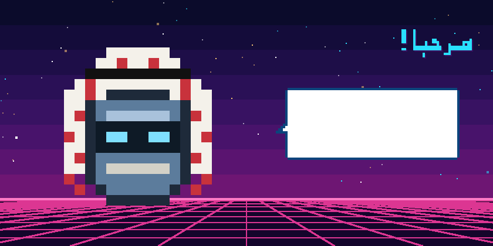
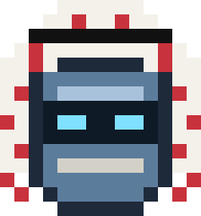

<div align="center">


<div dir="rtl">

# زميل: روبوت بكسلي ومساعد صوتي ذكي يتحدث العربية على Mac

**يفهم كلامك بالعربية ويرد عليك بالعربية · ينفّذ المهام على جهازك بعد موافقتك · يدوّن ملاحظات اجتماعات Teams وZoom وMeet**

[English](README.md) · **العربية** · [الموقع](https://c0ldskin.github.io/zolt-bot/ar/) · [التحميل](https://github.com/c0ldskin/zolt-bot/releases/latest)

</div>

<a href="https://github.com/c0ldskin/zolt-bot/releases/latest"></a>

<a href="LICENSE"></a>



</div>

<div dir="rtl">

## 👋 تعرّف على زميل

**زميل** روبوت بكسلي صغير يعيش في زاوية شاشتك، يرتدي الشماغ والعقال. اضغط عليه (أو اضغط **⌃⌥Z** من أي مكان)، وقل له ما تريد بالعربية، وسيجيبك بالعربية في فقاعة كلام وبصوت مسموع. عقله هو [Claude Code](https://claude.com/claude-code)، لذلك هو ذكي فعلاً، ويستخدم **حسابك أنت** في Claude.

زميل هو الأخ العربي لـ **زولت** ⚡، الروبوت الأزرق الذي يتحدث الإنجليزية بصوت روبوتات الثمانينيات. يمكنك تشغيل الاثنين معاً على الجهاز نفسه.

## ✨ ماذا يستطيع أن يفعل؟

| | |
|---|---|
| 🎙️ **تحدّث معه بالعربية** | اضغط عليه وتكلّم، وسيرسل كلامك عندما تتوقف. أو اكتب له بدلاً من ذلك. |
| 🛠️ **ينفّذ المهام على جهازك** | «ذكّرني أتصل بأمي الساعة 6»، «ارفع الصوت إلى 30%»، «افتح Spotify». **كل** إجراء يظهر لك أولاً في نافذة «سماح / رفض»، والرفض هو الخيار الافتراضي. |
| 👀 **ينظر إلى شاشتك** | «انظر إلى ملفي في LinkedIn، ماذا أحسّن؟» يلتقط صورة واحدة فقط وعندما تطلب ذلك. |
| 📝 **ملاحظات الاجتماعات** | يلاحظ بداية اجتماع Teams أو Zoom أو Google Meet **ويسألك** قبل أن يبدأ التدوين، ثم يكتب ملخصاً وقرارات ومهام. |
| 💡 **اقتراح إجابات** | ميزة اختيارية: عندما يُطرح عليك سؤال في الاجتماع، تظهر لك إجابة مقترحة في نافذة الملاحظات فقط، ولا ينطق بها أبداً. |
| 🌙 **له شخصية** | يرمش ويلتفت، ويقفز فرحاً عندما تخطر له فكرة، ويأخذ قيلولة عندما تبتعد عن الجهاز. |

> **ملاحظة:** ملاحظات الاجتماعات ما زالت بالإنجليزية حالياً، لأن نظام macOS لا يوفّر بعد تفريغاً صوتياً عربياً للاجتماعات الطويلة. الأوامر الصوتية والردود كلها بالعربية.

## 🚀 البدء السريع

**تحتاج إلى:** نظام macOS 26 أو أحدث (معالج Apple أو Intel) وحساب Claude.

**الخطوة 1: أعطِ زميل عقلاً.** ثبّت Claude Code، ثم شغّل الأمر `claude` مرة واحدة وسجّل الدخول:

</div>

```bash
curl -fsSL https://claude.ai/install.sh | bash
```

<div dir="rtl">

**الخطوة 2: حمّل زميل.**

1. حمّل الملف **Zamil-x.y.z.zip** من [آخر إصدار](https://github.com/c0ldskin/zolt-bot/releases/latest)، وفك الضغط، واسحب **Zamil** إلى مجلد التطبيقات.
2. افتحه. في المرة الأولى سيقول macOS إنه لا يستطيع التحقق من التطبيق، لأنه غير موقّع بشهادة Apple مدفوعة بعد.
3. اذهب إلى **إعدادات النظام ← الخصوصية والأمان**، وانزل للأسفل، واضغط **فتح على أي حال** بجانب Zamil. تفعل هذا مرة واحدة فقط.

أو ابنِه بنفسك من الكود المصدري:

</div>

```bash
git clone https://github.com/c0ldskin/zolt-bot.git
cd zolt-bot
./build.sh --character zamil --run --shortcut
```

<div dir="rtl">

**الخطوة 3: قل له مرحباً!** في أول استخدام سيطلب macOS الإذن للميكروفون والتعرّف على الكلام.

## 🔒 الأمان والخصوصية

- 🎙️ الميكروفون يعمل **فقط** عندما تضغط على زميل، أو عندما توافق على تدوين اجتماع.
- ✋ كل إجراء على جهازك وكل بحث في الإنترنت يحتاج إلى ضغطة **سماح** منك، وتعرض النافذة الأمر كاملاً مهما كان طويلاً.
- 🔐 لا يقرأ زميل أبداً الأماكن التي تحتوي على كلمات مرور أو مفاتيح، مثل `.ssh` وسلسلة المفاتيح وبيانات المتصفح وملفات `.env`.
- 📝 لا يبدأ تدوين الاجتماعات من تلقاء نفسه أبداً، ويذكّرك بإخبار الحاضرين أنه يتم التدوين.
- 🌐 الأوامر الصوتية تمرّ عبر خدمة التعرّف على الكلام من Apple، والنصوص التي ترسلها تذهب إلى Claude عبر حسابك.

## 🤝 شارك

عندك فكرة أو وجدت مشكلة؟ شاركنا في [النقاشات](https://github.com/c0ldskin/zolt-bot/discussions) أو [افتح بلاغاً](https://github.com/c0ldskin/zolt-bot/issues/new/choose). نرحّب بالمساهمات، وخاصة الشخصيات الجديدة والحركات واللغات.

## 📜 الرخصة

[MIT](LICENSE). ابنِ رفيقك الصغير الخاص بك.

</div>

<div align="center">
<br>

<br>
<sub>صُنع بالبكسلات الصغيرة وكثير من «بيب بوب». غير تابع لـ Anthropic أو Apple أو Microsoft.</sub>
</div>
