<div align="center">

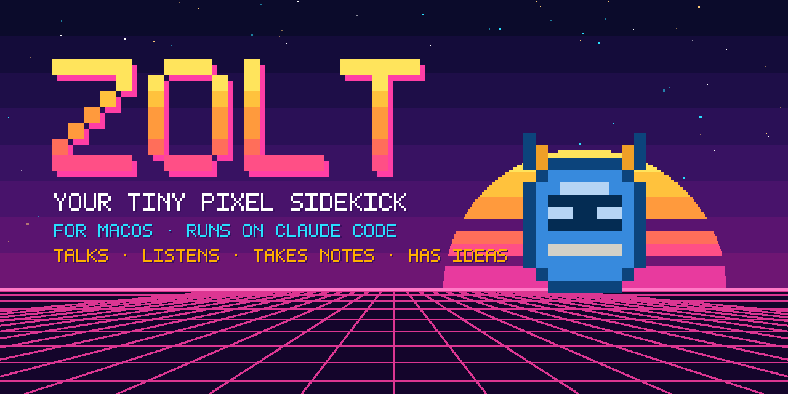

# Zolt: a pixel desktop pet & AI assistant for macOS

**Talks in an 80s robot voice · Does things on your Mac (with your OK) · Takes Teams, Zoom & Meet notes · Speaks Arabic as Zamil 🇸🇦**

**English** · [العربية](README.ar.md) · [Website](https://c0ldskin.github.io/zolt-bot/) · [Download](https://github.com/c0ldskin/zolt-bot/releases/latest)

<br>

<a href="#-quick-start"></a>

<a href="https://claude.com/claude-code"></a>

<a href="LICENSE"></a>
<br>
<a href="https://github.com/c0ldskin/zolt-bot/releases/latest"></a>
<a href="https://github.com/c0ldskin/zolt-bot/actions/workflows/build.yml"></a>
<a href="https://github.com/c0ldskin/zolt-bot/releases"></a>
<a href="https://github.com/c0ldskin/zolt-bot/stargazers"></a>

### 🤖 A tiny pixel robot that floats on your desktop, listens when you call, talks back in a glorious 80s robot voice, does things on your Mac (with your OK), and takes your meeting notes.

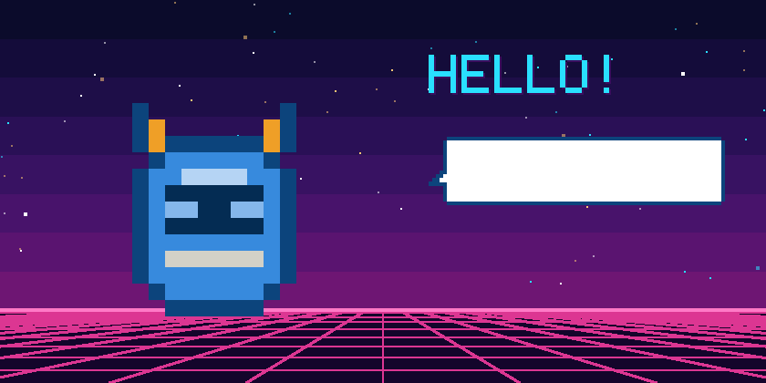

</div>

---

> ### 🛡️ Safe by design: an agent that asks before it acts
> - **Every action and web search waits for your Allow**, in a dialog that shows the full command. Deny is the default, and it denies by itself after 90 seconds.
> - **Secrets are off-limits:** file reads of SSH keys, cloud credentials, Keychains, browser and password-manager data and `.env` files are refused, and so is any shell command that names them.
> - **Meeting text can't trigger anything:** summaries and suggested answers run with every tool switched off.
> - **Nothing starts on its own:** the mic listens only when you click, and meeting notes always ask first.
>
> What Zolt can and can't do, and why: **[SAFETY.md](SAFETY.md)**

## 👾 Meet Zolt

**Zolt** (Z + volt ⚡) lives in the corner of your screen. Click it (or press **⌃⌥Space** from anywhere), say something, and it answers in a speech bubble that scrolls along as it talks. Its brain is [Claude Code](https://claude.com/claude-code), so it's actually smart, and it uses **your own** Claude account.

<div align="center">
<table>
  <tr>
    <td align="center">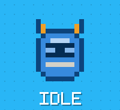<br><sub>Blinks & looks around</sub></td>
    <td align="center">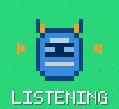<br><sub>Sound waves = all ears</sub></td>
    <td align="center">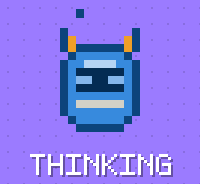<br><sub>Dot dot dot…</sub></td>
    <td align="center">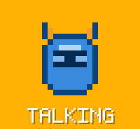<br><sub>Mouth flaps with the voice</sub></td>
  </tr>
  <tr>
    <td align="center">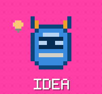<br><sub>Lightbulb + happy hop</sub></td>
    <td align="center">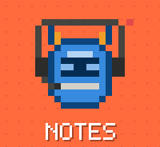<br><sub>Headset on, red light blinking</sub></td>
    <td align="center">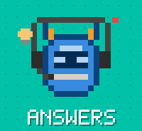<br><sub>Spotted a question for you</sub></td>
    <td align="center">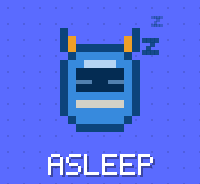<br><sub>Naps after 5 quiet minutes</sub></td>
  </tr>
</table>
</div>

## 🇸🇦 Meet Zamil (زميل)

<div align="center">
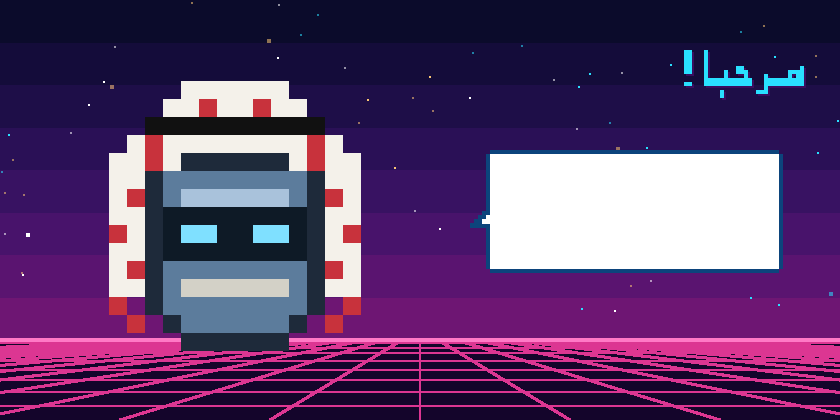
</div>

**Zamil** means *companion* in Arabic, and it's Zolt's Arabic-speaking sibling. It wears a red-and-white shemagh with a black agal, **understands spoken Arabic**, and **replies in Arabic** in a warm, natural tone (or in English if you write to it in English). Its speech bubble runs right to left.

- Same app and features as Zolt, with its own name, icon, voice (Majed) and hotkey: **⌃⌥Z**
- Runs happily **side by side** with Zolt; each keeps its own settings in `~/.zamil`
- Build it with `./build.sh --character zamil --run --shortcut`
- For now, meeting notes are in English, because macOS doesn't offer Arabic meeting transcription yet

<div align="center">
<table>
  <tr>
    <td align="center"></td>
    <td align="center"></td>
    <td align="center">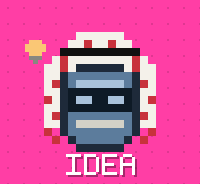</td>
    <td align="center">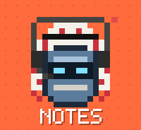</td>
  </tr>
</table>
</div>

## ✨ What it can do

| | |
|---|---|
| 🎙️ **Talk to it** | Click Zolt or hit **⌃⌥Space**, speak, and it sends when you stop. Or type instead. |
| 📼 **80s robot voice** | Replies read aloud with classic Mac voices: Zarvox, Trinoids, Fred, Ralph… or switch it off. |
| 🛠️ **Does things on your Mac** | *"Remind me to call Mom at 6"*, *"set volume to 30%"*, *"open Spotify"*. **Every** action shows an Allow/Deny dialog first (Deny is the default). |
| 👀 **Looks at your screen** | *"Look at my LinkedIn, what would you improve?"* One screenshot, only when you ask, with Zolt's own windows left out. |
| 📝 **Meeting notes** | Notices a **Teams, Zoom or Google Meet** call and *asks* before taking notes. You get a live transcript window that grows with the call, then a TL;DR, decisions and action items. |
| 💡 **Suggested answers** | Optional: when someone on the call asks a question, a suggested answer quietly appears in your notes window. It never speaks into the call. |
| 📚 **Prepare for a call** | Feed it PDFs, PowerPoints, Word files, text or web pages before the call, and suggested answers come from them, with the source named. |
| 🌙 **Has a life** | Pops in with ideas every 45 min, naps when you're away, wobbles when you drag it. |

## 🚀 Quick start

**You need:** macOS 26 (Tahoe) or later (Apple Silicon or Intel) and a paid Claude account (Pro, Max, Ultra, Team, Enterprise or Console). The free Claude plan doesn't include Claude Code.

### Step 1: give Zolt a brain

Zolt thinks with [Claude Code](https://claude.com/claude-code). Install it, then run `claude` once and sign in:

```bash
curl -fsSL https://claude.ai/install.sh | bash
```

### Step 2: get Zolt

**Option A: download** (easiest)

1. Grab **Zolt-x.y.z.zip** from the [latest release](https://github.com/c0ldskin/zolt-bot/releases/latest), unzip it, and drag **Zolt** into your Applications folder.
2. Open it. The first time, macOS says it can't check the app, because Zolt isn't signed with a paid Apple Developer certificate yet.
3. Go to **System Settings → Privacy & Security**, scroll down, click **Open Anyway** next to Zolt, and confirm. You only do this once.

**Option B: Homebrew** 🍺

```bash
brew tap c0ldskin/tap
brew trust c0ldskin/tap          # newer Homebrew asks you to trust third-party taps once
brew install --cask zolt         # or: brew install --cask zamil
```

**Option C: build it yourself** (no Xcode needed, just Apple's command-line tools)

```bash
xcode-select --install          # skip if you already have it
git clone https://github.com/c0ldskin/zolt-bot.git
cd zolt-bot
./build.sh --run --shortcut
```

`build.sh` compiles with `swiftc`, draws the app icon from Zolt's own sprite, installs to `~/Applications/Zolt.app` and, with `--shortcut`, puts a **Zolt** shortcut on your Desktop. Builds you make yourself open without any warning.

### Step 3: say hi

Click Zolt and talk. The first time you use each feature, macOS asks for permission: **Microphone** and **Speech Recognition** to talk, **Screen & System Audio Recording** for screenshots and meeting audio.

## 🕹️ Controls

| Do this | And Zolt… |
|---|---|
| **Click** Zolt or press **⌃⌥Space** | starts listening |
| **Drag** Zolt | moves (and remembers the spot) |
| **Right-click** Zolt, or use the 🤖 in the menu bar | opens the menu: type, look at screen, idea, notes, voice, settings |
| **Click** the speech bubble | closes it (or opens your notes after a meeting) |
| **Scroll** the bubble | takes over from the auto-scroll |

## 🧠 How it works


- **Ears:** `SFSpeechRecognizer` for commands (Apple may process these on its servers); macOS 26's on-device `SpeechAnalyzer` for long meeting transcripts. English (US) only for now.
- **Brain:** the Claude Code CLI in print mode, with a persona prompt and conversation memory in `~/.zolt`.
- **Hands:** Claude Code's `PreToolUse` hook calls back into Zolt's own binary (`Zolt --confirm`), which shows the Allow/Deny dialog. No permission bypass, ever.
- **Meeting audio:** a Core Audio *process tap* on just the meeting app, plus your mic. The notes window shows "You" and "Others".
- **Face:** a 14×13 pixel grid drawn with plain rectangles at 30 fps. All the art on this page is rendered from that same code.

## 🔒 Safety & privacy

The full picture, including known limits, is in **[SAFETY.md](SAFETY.md)**.


- 🎙️ The mic is on **only** while Zolt is listening (you clicked it) or taking notes (you said yes).
- ✋ Every action on your Mac needs an explicit **Allow**, and so does every web search. The dialog always shows the full command, however long it is.
- 📖 Zolt can read files in your home folder without asking (that's how it answers questions about them), **except** places that hold secrets: `.ssh`, `.aws`, `.gnupg`, Keychains, browser and password-manager data, Mail, Messages, `.env` files and similar. File reads of those are blocked twice, by Claude Code's own deny rules and by Zolt's approval hook. The hook also refuses any shell command that names them. A command that hides the path would still reach the Allow dialog, so read it before you click.
- 🧱 Zolt treats text from web pages, files and screenshots as information, not instructions.
- 📝 Zolt **never** starts meeting notes by itself, and it reminds you to tell people they're being transcribed. Check your workplace's rules before using it at work.
- 💡 Suggested answers stay in the Live notes window. They're never spoken or posted. That window is a normal window, though, so **share a single window, not your whole screen**.
- 🌐 **What leaves your Mac:**
  - **Voice commands** go through Apple's speech recognition, which may process them on Apple's servers.
  - **Meeting audio** is transcribed on your Mac and never sent anywhere as audio.
  - **Text sent to Claude** through your own Claude Code login: what you say or type to Zolt, screenshots you ask about, files Zolt reads to answer you, meeting transcripts (for summaries and suggested answers), and the passages of your briefing that match a question.
- 🗂️ Everything is stored locally: `~/.zolt` (conversation id and a small troubleshooting log that records what Zolt did, never what anyone said) and `~/Zolt Meeting Notes` (Markdown notes).

## 🎨 Make it yours

Every character's face is a little grid of letters in [`Sources/Robot.swift`](Sources/Robot.swift). Here's Zolt's:

```swift
grid: [
    "..o........o..",
    "..oa......ao..",
    "..oaooooooao..",
    "...obbbbbbo...",
    "..obbllllbbo..",
    "..obssssssbo..",
    "..obeesseebo..",   // e = eyes
    "..obssssssbo..",
    "..obbbbbbbbo..",
    "..obmmmmmmbo..",   // m = mouth
    "..obbbbbbbbo..",
    "...obbbbbbo...",
    "....oooooo....",
],
```

Change the letters or the `palette` colors, run `./build.sh`, and you've got your own bot. Or add a whole new character next to Zolt and Zamil, with its own language and hotkey. Regenerate the README art from your new design with:

```bash
build/Zolt.app/Contents/MacOS/Zolt --render-art art
```

## 🩹 Troubleshooting

<details>
<summary><b>"I can't find my brain!" / "Not logged in"</b></summary>

Install Claude Code (see Quick start), run `claude` once in Terminal and sign in, then restart Zolt.
</details>

<details>
<summary><b>The mic or screen stopped working after I rebuilt Zolt</b></summary>

macOS ties permissions to the app's signature, and every local build gets a new one. Reset them and allow again:

```bash
tccutil reset Microphone io.github.c0ldskin.zolt; tccutil reset SpeechRecognition io.github.c0ldskin.zolt
```

For screenshots and meeting audio: System Settings → Privacy & Security → **Screen & System Audio Recording** → remove Zolt with **−**, add it back with **+**, then reopen Zolt.
</details>

<details>
<summary><b>My meeting isn't detected</b></summary>

Zolt looks for Teams, Zoom or a browser using the mic. `~/.zolt/zolt.log` lists which apps are using the mic. You can always right-click Zolt → **Start taking notes** by hand.
</details>

<details>
<summary><b>Words show up twice in my notes</b></summary>

Wear headphones. Without them, your mic hears the call too. Zolt drops most echoes, but headphones work best.
</details>

<details>
<summary><b>Start Zolt when I log in</b></summary>

System Settings → General → Login Items → **+** → pick `~/Applications/Zolt.app`.
</details>

## 🗺️ Roadmap

- [x] Voice chat with an 80s robot voice
- [x] Actions on your Mac, with Allow/Deny for each one
- [x] Screen viewing
- [x] Meeting notes for Teams, Zoom and Meet, with a live transcript
- [x] Suggested answers during calls
- [x] Downloadable app for Apple Silicon and Intel
- [ ] Signed and notarized download (no "Open Anyway" step)
- [ ] 🕺 A dance animation
- [ ] "Hey Zolt" wake word
- [ ] Always-allow list for harmless actions
- [ ] Skins: swap in your own pixel character
- [ ] More languages than US English

Got an idea? Share it in [Discussions](https://github.com/c0ldskin/zolt-bot/discussions) or [open an issue](https://github.com/c0ldskin/zolt-bot/issues/new/choose). Zolt loves ideas. 💡

## 🤝 Contributing

PRs welcome, especially new animations, skins and moods. See [CONTRIBUTING.md](CONTRIBUTING.md).

## 📜 License

[MIT](LICENSE). Go build your own little buddy.

<div align="center">
<br>
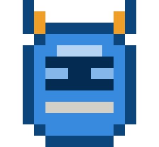
<br>
<sub>Built by <a href="https://github.com/c0ldskin">Zeeshan Mehdi</a>, CTO by day, agent tinkerer by night. Also see <a href="https://c0ldskin.github.io/fitrah/">Fitrah (فطرة)</a>, research on agents that are born with trust.</sub>
<br>
<sub>Made with tiny pixels and a lot of beep-boop. Not affiliated with Anthropic, Apple or Microsoft.</sub>
</div>
