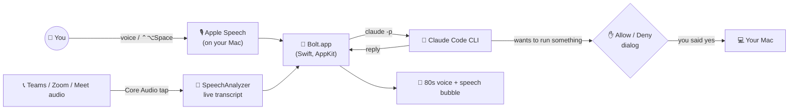

<div align="center">


<br>

<a href="#-quick-start"></a>

<a href="https://claude.com/claude-code"></a>

<a href="LICENSE"></a>

### 🤖 A tiny pixel robot that floats on your desktop, listens when you call, talks back in a glorious 80s robot voice, does things on your Mac (with your OK), and takes your meeting notes.


</div>

---

## 👾 Meet Bolt

Bolt lives in the corner of your screen. Click it (or press **⌃⌥Space** from anywhere), say something, and it answers in a speech bubble that scrolls along as it talks. Its brain is [Claude Code](https://claude.com/claude-code), so it's actually smart, and it uses **your own** Claude account.

<div align="center">
<table>
  <tr>
    <td align="center"><br><sub>Blinks & looks around</sub></td>
    <td align="center"><br><sub>Sound waves = all ears</sub></td>
    <td align="center"><br><sub>Dot dot dot…</sub></td>
    <td align="center"><br><sub>Mouth flaps with the voice</sub></td>
  </tr>
  <tr>
    <td align="center"><br><sub>Lightbulb + happy hop</sub></td>
    <td align="center"><br><sub>Headset on, red light blinking</sub></td>
    <td align="center"><br><sub>Spotted a question for you</sub></td>
    <td align="center"><br><sub>Naps after 5 quiet minutes</sub></td>
  </tr>
</table>
</div>

## ✨ What it can do

| | |
|---|---|
| 🎙️ **Talk to it** | Click Bolt or hit **⌃⌥Space**, speak, and it sends when you stop. Or type instead. |
| 📼 **80s robot voice** | Replies read aloud with classic Mac voices: Zarvox, Trinoids, Fred, Ralph… or switch it off. |
| 🛠️ **Does things on your Mac** | *"Remind me to call Mom at 6"*, *"set volume to 30%"*, *"open Spotify"*. **Every** action shows an Allow/Deny dialog first (Deny is the default). |
| 👀 **Looks at your screen** | *"Look at my LinkedIn, what would you improve?"* One screenshot, only when you ask, with Bolt's own windows left out. |
| 📝 **Meeting notes** | Notices a **Teams, Zoom or Google Meet** call and *asks* before taking notes. You get a live transcript window that grows with the call, then a TL;DR, decisions and action items. |
| 💡 **Suggested answers** | Optional: when someone on the call asks a question, a suggested answer quietly appears in your notes window. It never speaks into the call. |
| 🌙 **Has a life** | Pops in with ideas every 45 min, naps when you're away, wobbles when you drag it. |

## 🚀 Quick start

**You need:** macOS 26 (Tahoe) or later · Apple's Command Line Tools · a Claude account

```bash
# 1. Apple's compiler (skip if you already have it)
xcode-select --install

# 2. Claude Code, Bolt's brain. Run `claude` once afterwards to sign in.
curl -fsSL https://claude.ai/install.sh | bash

# 3. Grab Bolt and build it
git clone https://github.com/c0ldskin/bolt-buddy.git
cd bolt-buddy
./build.sh --run
```

That's it. No Xcode project and no dependencies: `build.sh` compiles with `swiftc`, draws the app icon from Bolt's own sprite, installs to `~/Applications/Bolt.app` and drops a **Bolt** shortcut on your Desktop.

The first time you use each feature, macOS asks for permission: **Microphone** and **Speech Recognition** to talk, **Screen & System Audio Recording** for screenshots and meeting audio.

## 🕹️ Controls

| Do this | And Bolt… |
|---|---|
| **Click** Bolt or press **⌃⌥Space** | starts listening |
| **Drag** Bolt | moves (and remembers the spot) |
| **Right-click** Bolt, or use the 🤖 in the menu bar | opens the menu: type, look at screen, idea, notes, voice, settings |
| **Click** the speech bubble | closes it (or opens your notes after a meeting) |
| **Scroll** the bubble | takes over from the auto-scroll |

## 🧠 How it works



- **Ears:** `SFSpeechRecognizer` for commands; macOS 26's `SpeechAnalyzer` for long meeting transcripts.
- **Brain:** the Claude Code CLI in print mode, with a persona prompt and conversation memory in `~/.bolt`.
- **Hands:** Claude Code's `PreToolUse` hook calls back into Bolt's own binary (`Bolt --confirm`), which shows the Allow/Deny dialog. No permission bypass, ever.
- **Meeting audio:** a Core Audio *process tap* on just the meeting app, plus your mic. The notes window shows "You" and "Others".
- **Face:** a 14×13 pixel grid drawn with plain rectangles at 30 fps. All the art on this page is rendered from that same code.

## 🔒 Safety & privacy

- 🎙️ The mic is on **only** while Bolt is listening (you clicked it) or taking notes (you said yes).
- ✋ Every action on your Mac needs an explicit **Allow**. Reading files and web searches don't ask.
- 📝 Bolt **never** starts meeting notes by itself, and it reminds you to tell people they're being transcribed. Check your workplace's rules before using it at work.
- 💡 Suggested answers stay in the Live notes window. They're never spoken or posted. That window is a normal window, though, so **share a single window, not your whole screen**.
- 📁 Transcription happens on your Mac. Text you send to Bolt, screenshots you ask about, and meeting transcripts (for the summary) go to Claude through your own Claude Code login.
- 🗂️ Everything is stored locally: `~/.bolt` (logs and conversation id) and `~/Bolt Meeting Notes` (Markdown notes).

## 🎨 Make it yours

Bolt's whole face is a little grid of letters in [`Sources/main.swift`](Sources/main.swift):

```swift
let boltGrid = [
    "..o........o..",
    "..oa......ao..",
    "..oaooooooao..",
    "...obbbbbbo...",
    "..obbllllbbo..",
    "..obssssssbo..",
    "..obeesseebo..",   // e = eyes
    "..obssssssbo..",
    "..obbbbbbbbo..",
    "..obmmmmmmbo..",   // m = mouth
    "..obbbbbbbbo..",
    "...obbbbbbo...",
    "....oooooo....",
]
```

Change the letters or the `palette` colors, run `./build.sh`, and you've got your own bot. Regenerate the README art from your new design with:

```bash
build/Bolt.app/Contents/MacOS/Bolt --render-art art
```

## 🩹 Troubleshooting

<details>
<summary><b>"I can't find my brain!" / "Not logged in"</b></summary>

Install Claude Code (see Quick start), run `claude` once in Terminal and sign in, then restart Bolt.
</details>

<details>
<summary><b>The mic or screen stopped working after I rebuilt Bolt</b></summary>

macOS ties permissions to the app's signature, and every local build gets a new one. Reset them and allow again:

```bash
tccutil reset Microphone local.minime.bolt; tccutil reset SpeechRecognition local.minime.bolt
```

For screenshots and meeting audio: System Settings → Privacy & Security → **Screen & System Audio Recording** → remove Bolt with **−**, add it back with **+**, then reopen Bolt.
</details>

<details>
<summary><b>My meeting isn't detected</b></summary>

Bolt looks for Teams, Zoom or a browser using the mic. `~/.bolt/bolt.log` lists which apps are using the mic. You can always right-click Bolt → **Start taking notes** by hand.
</details>

<details>
<summary><b>Words show up twice in my notes</b></summary>

Wear headphones. Without them, your mic hears the call too. Bolt drops most echoes, but headphones work best.
</details>

<details>
<summary><b>Start Bolt when I log in</b></summary>

System Settings → General → Login Items → **+** → pick `~/Applications/Bolt.app`.
</details>

## 🗺️ Roadmap

- [x] Voice chat with an 80s robot voice
- [x] Actions on your Mac, with Allow/Deny for each one
- [x] Screen viewing
- [x] Meeting notes for Teams, Zoom and Meet, with a live transcript
- [x] Suggested answers during calls
- [ ] 🕺 A dance animation
- [ ] "Hey Bolt" wake word
- [ ] Always-allow list for harmless actions
- [ ] Skins: swap in your own pixel character
- [ ] Redraw only when something changes, to save battery

Got an idea? [Open an issue](../../issues). Bolt loves ideas. 💡

## 🤝 Contributing

PRs welcome, especially new animations, skins and moods. See [CONTRIBUTING.md](CONTRIBUTING.md).

## 📜 License

[MIT](LICENSE). Go build your own little buddy.

<div align="center">
<br>

<br>
<sub>Made with tiny pixels and a lot of beep-boop. Not affiliated with Anthropic, Apple or Microsoft.</sub>
</div>
